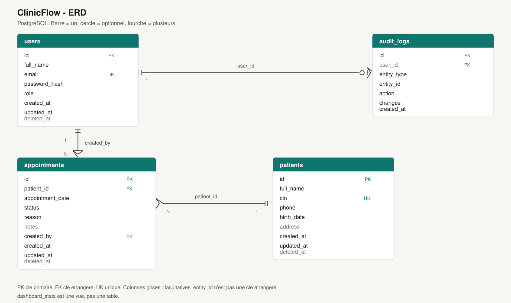

# Conception

Schéma entité-association de ClinicFlow. Le dessin est dans [erd.svg](erd.svg).

## Relations

**1-1 — aucune.** Aucune entité n’a exactement une ligne liée, obligatoire et exclusive. Un patient n’a pas un seul rendez-vous, et un compte n’a pas une fiche profil séparée.

**1-N**

- Un patient a plusieurs rendez-vous. Chaque rendez-vous concerne un seul patient (`appointments.patient_id`, obligatoire, `ON DELETE RESTRICT`).
- Un utilisateur crée plusieurs rendez-vous. Chaque rendez-vous a un seul auteur (`appointments.created_by`, obligatoire, `ON DELETE RESTRICT`).
- Un utilisateur produit plusieurs lignes d’audit. Chaque ligne a au plus un auteur (`audit_logs.user_id`, facultatif, `ON DELETE SET NULL`).

**N-N — aucune.** Pas de table de jointure. Un rendez-vous n’est pas partagé entre plusieurs patients, ni attribué à plusieurs soignants.

`audit_logs.entity_id` n’est pas une clé étrangère. Avec `entity_type`, il désigne une ligne de `users`, `patients` ou `appointments`. `dashboard_stats` est une vue de comptage, pas une entité.
